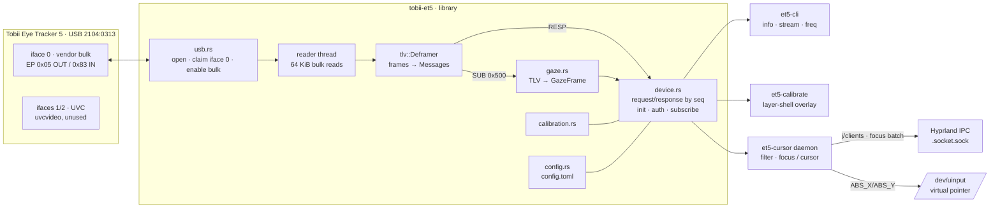

# Architecture



## Crates

| crate | responsibility |
|---|---|
| `tobii-et5` | USB transport (rusb), TLV encode/decode and framing, init/auth/subscribe, gaze parsing, frequency queries, calibration commands, display geometry config, reopen-on-failure logic |
| `et5-cli` | diagnostics: `info`, `stream [secs]` (rate, samples, pixel coords), `freq list/get` |
| `et5-calibrate` | fullscreen Wayland layer-shell overlay (smithay-client-toolkit, software-rendered shm) running the 7-point calibration and saving the blob |
| `et5-cursor` | user daemon: gaze → one-euro filter → **focus** (Hyprland IPC) or **cursor** (uinput); control socket and toggle client |

## USB and protocol

- Interface 0 only (vendor class). Interfaces 1/2 are UVC; `uvcvideo` fails to bind them
  (`-22`) and they are ignored. The configuration is **only set when it is not already 1**:
  re-setting it while uvcvideo holds 1/2 makes xhci log *"add endpoint 0x82 without
  dropping it"* and can wedge the device. The code **never issues a USB reset** (a reset
  once made the tracker drop off the bus until replugged).
- After claiming, a vendor control request (`bmRequestType 0x41, bRequest 0x41`) enables
  the bulk endpoints.
- **Outbound** frame: `LE32 0 · LE32 content_len · content`, content split into ≤4087-byte
  transfers. **Inbound** frame: `LE32 id · LE32 total_len (incl. 8-byte header) · content`.
- Content: `BE32 type · BE32 seq · BE32 hi · BE32 prop · BE32 status · BE32 inner_len · [00 00 TLV…]`.
  Types: `0x51` request, `0x52` response (hi = 1), `0x53` stream data, `0x4E` notification.
  TLV tags: `02` int32, `03` Q16.16, `04` Q32.32, `05` sub-id, `06` u64, `14` string,
  `15` binary, `17` int32 array (all big-endian).
- Messages larger than one transfer (the ~360 KB calibration blob) are reassembled by the
  `Deframer` using `inner_len`.

### Init sequence (`Device::init`, after nottobii)

```
UPGRADE(0x3E8, streams 0x10000..0x10008)
[CALIBRATE_UPLOAD(blob)]            only if ~/.config/tobii-et5/<serial>/calibration.bin exists
CONFIG_3D_SET(display corners TL,TR,BL in µm, tag 12345)
AUTH_CHALLENGE(10002,[0]) → AUTH_VERIFY(10002,0,hash,sig) → MOUNTING_CONFIG → AUTH_FINALIZE(10002)
STATUS_GET · PAUSE_SET(1) · ENABLED_EYE_SET(3)
[CALIBRATE_UPLOAD(blob)]
start_gaze: STREAM_SUBSCRIBE(0x500), STREAM_SUBSCRIBE(0x504), PAUSE_SET(0), CONFIG_3D_SET
```

AUTH_VERIFY and MOUNTING_CONFIG answer `0x20000505`; streaming works regardless.
An empty blob is rejected (`0x20000503`), so it is skipped when absent.

### Reopen quirk

Roughly every other session misbehaves: either a request (typically `PAUSE_SET`) is never
answered, or the gaze stream stays silent after a successful subscribe. Re-subscribing in
the same session does not help; closing and reopening does. `Device::open_ready` /
`open_streaming` retry up to 4 times. `Device::drop` pauses and unsubscribes, and
`et5-cursor` handles SIGTERM so that `systemctl stop` runs that cleanup.

## Data path

```
USB transfer (1724 B, ~33 Hz) → Deframer → gaze::parse → GazeFrame{left,right,combined 0..1}
   → no eyes? freeze
   → pixels (× 5120/1440) → one-euro filter (min_cutoff, beta, d_cutoff; reset on saccade)
       ├─ focus mode: hit_test(windows, margin) → same window for dwell_ms → focus
       └─ cursor mode: dead zone → follow / saccade jump → uinput ABS_X/ABS_Y
```

### Focus mode and Hyprland IPC

- Socket: `$XDG_RUNTIME_DIR/hypr/$HYPRLAND_INSTANCE_SIGNATURE/.socket.sock` (falls back to
  the newest instance directory if the signature is not in the service environment).
- Polled only while ON: `j/cursorpos` at 10 Hz (mouse moved → pause `mouse_quiet_ms`),
  `j/activeworkspace`, `j/activewindow`, `j/clients`, `j/layers` at 4 Hz.
- Suspended when the workspace has a fullscreen window, a floating window is focused, or a
  layer other than bar/background/notifications is on the top/overlay level.
- Hyprland 0.56 uses the Lua config, so `keyword` is unavailable. The pointer would warp on
  focus (`cursor:no_warps = false`), so the daemon sends one batch:
  `eval hl.config({cursor={no_warps=true}}); dispatch hl.dsp.focus({window="address:0x…"}); eval hl.config({cursor={no_warps=false}})`.
  If `no_warps` is already `true`, only the dispatch is sent. Addresses are validated as hex
  before being put into Lua.

## Calibration

`et5-calibrate`: open+init+stream → 3 s countdown → `CALIBRATE_START`, `CLEAR` → points
(0.5,0.5) | (0.1,0.1) (0.9,0.1) (0.5,0.9) | (0.1,0.9) (0.9,0.9) (0.5,0.1); each dot shrinks
for 1.5 s, `SHOW_POINT(x·1024, y·1024, 3)` at 0.7 s; `COMPUTE` after each round →
`GET_STATUS` (blob) → `APPLY` → `STOP` → saved to `~/.config/tobii-et5/<serial>/calibration.bin`,
uploaded by every later `init`. Esc/q aborts and sends `STOP`.

## Integration

- **udev** (`udev/70-tobii-et5.rules`): `TAG+="uaccess"` on the tracker and `/dev/uinput`,
  so the logged-in user can open both without root.
- **systemd user unit** (`systemd/et5-cursor.service`): `WantedBy=graphical-session.target`,
  `Restart=on-failure`. Starts OFF. Reconnects every 3 s if the tracker is missing or silent.
- **Control socket**: `$XDG_RUNTIME_DIR/et5-cursor.sock`, line commands
  `toggle|on|off|status|mode focus|mode cursor`, reply `"<on|off> <focus|cursor>"`.
  The client shows a notification (`notify-send`).
- **Hotkey**: `o.bind("SUPER + ALT + E", …, "et5-cursor toggle")` in `~/.config/hypr/bindings.lua`.

## Config files

| file | contents |
|---|---|
| `~/.config/tobii-et5/config.toml` | display px and mm, tracker offset (validated) |
| `~/.config/tobii-et5/cursor.toml` | `mode`, `[focus]` dwell/margin/mouse quiet, `[filter]` one-euro + dead zone (clamped) |
| `~/.config/tobii-et5/<serial>/calibration.bin` | calibration blob |

## Known limits

- **33 Hz** gaze output. The tracker reports one frequency mode `{132, 33}`; no setter is
  known, and probing an unknown property reset the device.
- The every-other-session quirk costs about 1.5–3 s at startup.
- Single monitor assumed (gaze is mapped onto the configured display).
- Tested on one device (IS50F, firmware `02a1a6a977`) only.
